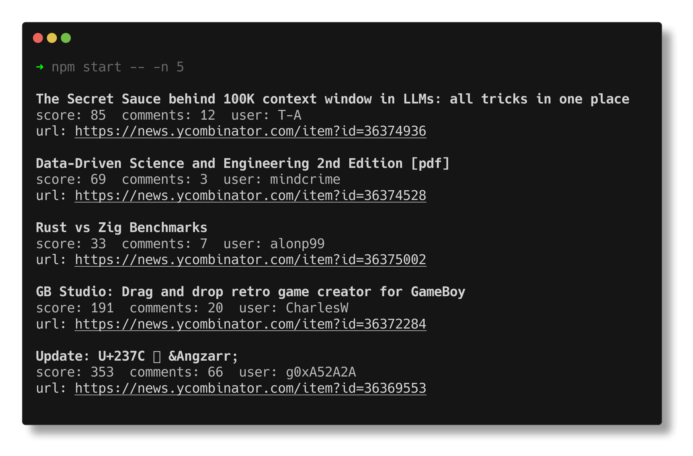

# Hacker News Fetcher



A fast command-line application that fetches and displays the top stories from Hacker News in a clean, easy-to-read format. It supports customization options such as the number of stories to fetch and whether to display source URLs. Ideal for quick updates without leaving your terminal.

This project is the Bun version of the [Go](https://github.com/amscotti/hacker_news) and [C#](https://github.com/amscotti/hn-top) implementations. It uses Bun's native `fetch` implementation for fast, pooled HTTP requests.

## Requirements

- [Bun](https://bun.sh/) 1.2 or newer

## Usage

The application supports the following command-line options:

```
Options:
  -n, --number      Number of top stories to show          [number] [default: 5]
  -u, --sourceUrls  Show source URLs                  [boolean] [default: false]
  -h, --help        Show help                                          [boolean]
  -v, --version     Show version number                                [boolean]
```

Fetch and display the top 10 stories with their source URLs:

```bash
bun start -- -n 10 -u
```

You can also run the entry point directly:

```bash
bun index.js -n 10 -u
```

## Build a standalone binary

Compile the application into a self-contained executable with Bun:

```bash
bun run build
./hn -n 10 -u
```

Prebuilt binaries for Linux, macOS, and Windows are attached to each [GitHub release](https://github.com/amscotti/hn-node/releases). Download the binary for your platform, make it executable, and run it:

```bash
chmod +x hn-darwin-arm64
./hn-darwin-arm64 -n 10 -u
```

macOS may require allowing the unsigned binary in System Settings > Privacy & Security.

## Development

Install dependencies:

```bash
bun install
```

Run the checks:

```bash
bun run lint
bun run format:check
bun test
```

Fix lint and formatting issues:

```bash
bun run lint:fix
bun run format
```

Coverage is available with:

```bash
bun run test:coverage
```

CI runs linting, formatting checks, unit tests, and a build on every pull request. Pushing a `v*` tag verifies the tag matches the package version, runs the same checks, and publishes standalone binaries for Linux, macOS, and Windows.

## License

This project is licensed under the MIT License.

## Contributing

Pull requests are welcome.
